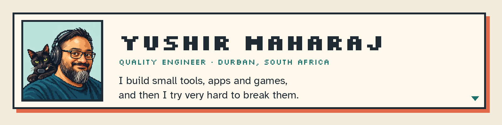

Quality engineer, over ten years in software testing. These days AI writes most of my code, and I spend my time checking it actually does what it's meant to. The full portfolio, with screenshots, is at **[fernwire.co.za](https://fernwire.co.za)**.

## Things I've built

**[Mzansi Tools](https://mzansitools.co.za)** · live  
Free South African calculators for pay and tax, home loans, cars and fuel, and more. Every calculator is covered by automated tests.

**[Colander](https://colander.fernwire.co.za)** · live on the Chrome Web Store  
A free browser extension that adds extra filters to Takealot search results: a star rating range to one decimal, a minimum number of reviews, and switches to hide sponsored products and slow delivery. Tested in Chrome, Brave and Firefox. It runs in your browser and sends nothing anywhere. Not affiliated with Takealot.

**[Last Light](https://yushirm.github.io/last-light/)** · free browser game · [repo](https://github.com/yushirm/last-light)  
A lighthouse with seven nights to bring back the Sun. Sweep the beam to hold back the dark and guide lost ships home. Plays on phones and desktops, and automated checks run on every change.

**[UNRESOLVED](https://unresolvedgame.vercel.app/)** · public beta  
A text adventure in the old DOS spirit: a cyberpunk-noir mystery told in ASCII, with jokes on top and something sadder underneath. Playable but unfinished. Bug reports go on the [public feedback board](https://github.com/yushirm/unresolved-feedback).

## How I test

**uNogwaja** · private, in daily use  
My testing playbook, written down so I can hand it to an AI agent: what good looks like, how to test a content site, a calculator, a login or a game, and the lessons each session teaches. It runs as a loop: charter, explore, report, retest, learn, heal. When a session teaches the agent something new, it proposes a rule change, and nothing changes until I've read it. Named after the clever hare of isiZulu folklore.

**Test automation samples** · public  
Practice suites against public demo sites:
- [Selenium framework in C#](https://github.com/yushirm/Automation-Selenium-SauceDemo) with page objects and Given-When-Then tests (2022)
- [Postman API suite](https://github.com/yushirm/Automation-Postman-OpenWeatherApi) for the OpenWeather API, with positive and negative checks (2022)
- [Playwright Java port](https://github.com/yushirm/automation-playwright-saucedemo) of the Selenium suite, with auto-waiting and GitHub Actions runs, made with Claude Code (2026)

## What I do for a living

- **Performance testing.** Over six years checking that large online gaming platforms could take the load: JMeter load, soak, spike and failover tests, with slowdowns traced through SQL Server, Redis, Couchbase, Kafka and RabbitMQ. Later, performance tests in C# with NBomber that ran alongside the code.
- **Mobile and API automation.** Java frameworks with Appium, Selenium and Rest Assured, running in CI, for a digital banking platform and an emergency-services platform: Android, iOS, web, APIs, and the data and messaging underneath.
- **Risk-based testing.** Owned my team's test plan for a money-transfer app on Android, iOS, USSD and WhatsApp, and decided what to test first by asking what would hurt someone sending money home if it broke.
- **Mentoring.** Junior testers and interns in every role, functional testers learning performance work, and tech talks for other testers.

ISTQB Advanced Level Technical Test Analyst (CTAL-TTA) and Foundation Level (CTFL). Before software, an honours degree in microbiology: lab work runs on the same habits as testing. Change one thing, measure what happens, and write it down.

## Apps for home

Private apps I built for my own life: a wedding planner for two that saw daily use right up to the big day, a rental-hunt tracker, and an electronics workshop tracker that makes me predict each reading before I measure it. Screenshots with sample data are on [the portfolio](https://fernwire.co.za).

## For fun

- **Wendan's Willow**: a tiny medieval village that runs itself. The residents work, eat, chat and remember. Not public yet.
- **[The Museum of Almost](https://yushirm.github.io/museum-of-almost/)** ([repo](https://github.com/yushirm/museum-of-almost)): an experiment in letting AI build its own content, a small online museum whose galleries and archives were written and built by AI. I set the boundaries: no tracking, no accounts, nothing stored about visitors.
- **[ouroboros](https://ouroboros.milo17.workers.dev/)** ([repo](https://github.com/yushirm/ouroboros)): a living creature made of the whole Earth, bent into a ring. It shivers with each new earthquake and breathes out a spore for every new wiki page. When a data source goes quiet, that part goes dark.

## Say hello

Questions about something here, or spotted a bug? Email **hello@fernwire.co.za**.
